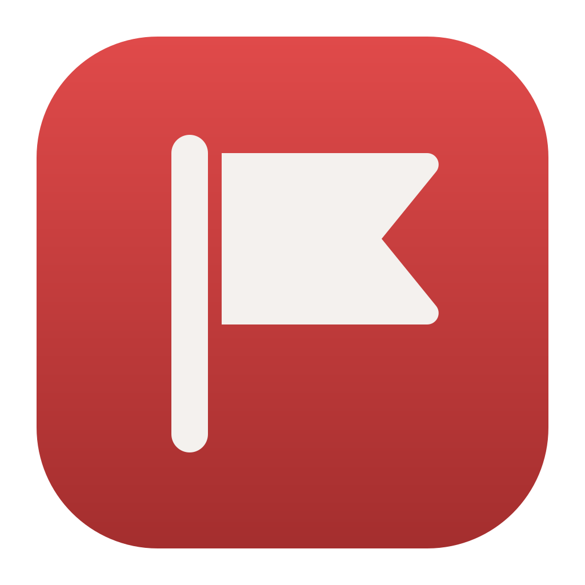

<h1 align="center">Flag</h1>

VPN-клиент для Windows с бесшовным переключением серверов

  <a href="https://github.com/F1LANT/flag/releases/latest"><b>Скачать последнюю версию</b></a>

## Что умеет

- **Протоколы:** VLESS (Reality, XHTTP), VMess, Trojan, Shadowsocks, Hysteria 2, TUIC, WireGuard и другие — всё, что поддерживают ядра mihomo и Xray.
- **Подписки:** обычные и формата Xray, с автообновлением.
- **Выборочный режим:** через VPN идут только выбранные приложения и сайты, остальное — напрямую. Или весь трафик целиком.
- **Свой сервер для приложения или сайта.**
- **Бесшовное переключение:** смена сервера, режима и списков не перезапускает туннель.
- **Режимы туннеля:** TUN (Mixed, System, gVisor, sing-box) и системный прокси; «Авто» сам подбирает рабочий.
- **Kill switch:** если VPN оборвался, интернет блокируется, чтобы приложения не показали настоящий адрес.
- **Автообновление:** приложение само сообщает о новой версии и ставит её одной кнопкой.

## Установка

1. Скачайте `Flag_…_x64-setup.exe` со страницы [последнего релиза](https://github.com/F1LANT/flag/releases/latest).
2. Запустите установщик. Windows SmartScreen может предупредить о неизвестном издателе: «Подробнее» → «Выполнить в любом случае».
3. Для режима TUN приложению нужны права администратора — оно запросит их при запуске.

Требования: Windows 10 или 11, 64-разрядная.

## Обновления

Начиная с версии 0.2.0 приложение проверяет этот репозиторий и предлагает обновиться само. Файлы обновлений подписаны; копия с неверной подписью не установится.
Если у вас версия 0.1.0, один раз установите новую вручную поверх старой — настройки сохранятся.

## Сторонние компоненты

В установщик входят неизменённые исполняемые файлы:

- [mihomo](https://github.com/MetaCubeX/mihomo) — GPL-3.0
- [Xray-core](https://github.com/XTLS/Xray-core) — MPL-2.0

По запросу из приложения скачивается [sing-box](https://github.com/SagerNet/sing-box) — GPL-3.0. Исходный код этих программ доступен по ссылкам выше.

В этом репозитории публикуются только готовые сборки Flag.
